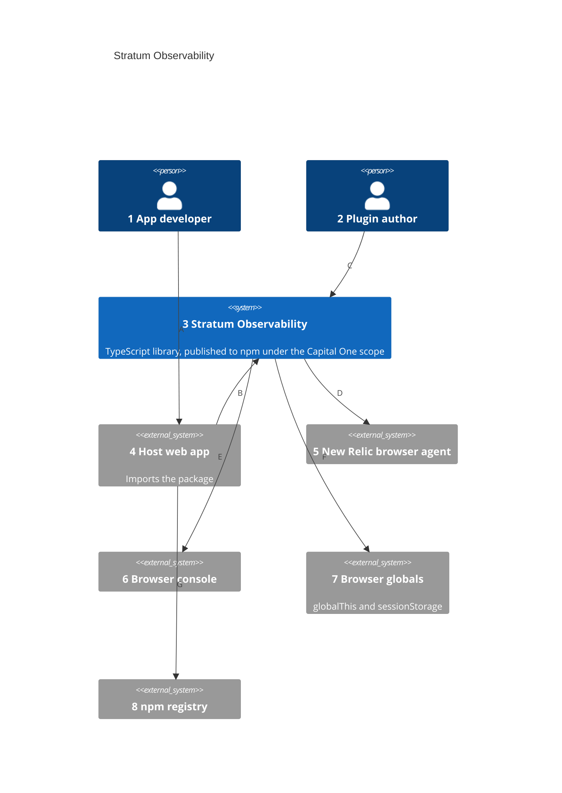
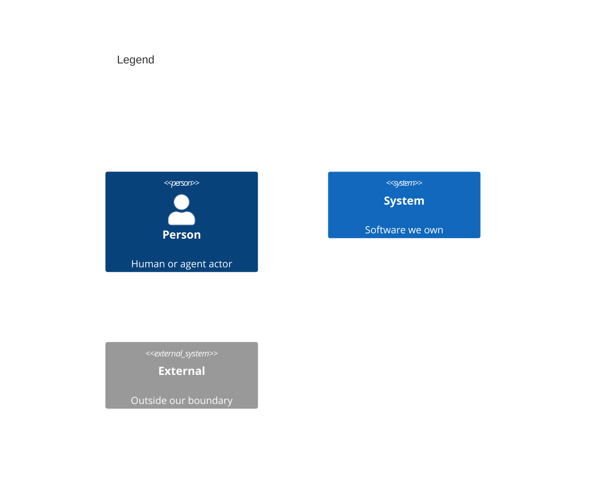

# System Context

Numbers on nodes and arrows match the callout table.

| #   | Description                                                                                           | Why                                                          |
| --- | ----------------------------------------------------------------------------------------------------- | ------------------------------------------------------------ |
| 1   | Writes event catalogs and wires plugins into one `StratumService` per app.                            | The library's main user.                                     |
| 2   | Extends `BasePlugin`, `BasePublisher`, and `BaseEventModel` to reach a new observability tool.        | Plugins are the extension point; the core knows no vendor.   |
| 3   | Validates catalog items, builds an event snapshot, and fans it out to every registered publisher.     | One standard event shape whatever the destination.           |
| 4   | A browser app that bundles the package and calls `publish` on user actions.                           | Stratum has no runtime of its own; it runs inside this app.  |
| 5   | The New Relic browser agent the host page loads; its SPA interaction API receives events.             | First bundled destination, used by two plugins.              |
| 6   | The page's `console`, written by the browser console plugin and by debug logging.                     | Zero-setup destination for local work.                       |
| 7   | Snapshot listeners and global plugins on `globalThis`; session ID and debug flag in `sessionStorage`. | Lets other scripts on the page observe and extend Stratum.   |
| 8   | Hosts the package with one entry point for the core and one per bundled plugin.                       | Plugins load only when the app imports them.                 |
| A   | Builds the app, defining catalogs and choosing plugins.                                               | All setup lives in app code.                                 |
| B   | Constructs the service, registers catalogs, and publishes events by catalog key.                      | Typed keys catch a missing event at compile time.            |
| C   | Ships a plugin package that the app passes to the service.                                            | Custom plugins need no change to the core.                   |
| D   | Opens, tags, and saves one SPA interaction per event.                                                 | Events land as queryable interactions with Stratum metadata. |
| E   | Logs each event as JSON, and debug lines when the flag is set.                                        | Visible output without any vendor account.                   |
| F   | Reads and writes globals and session storage, failing quietly where unavailable.                      | Works in browsers, tests, and server rendering alike.        |
| G   | Installs the package as a dependency.                                                                 | Standard npm distribution.                                   |
