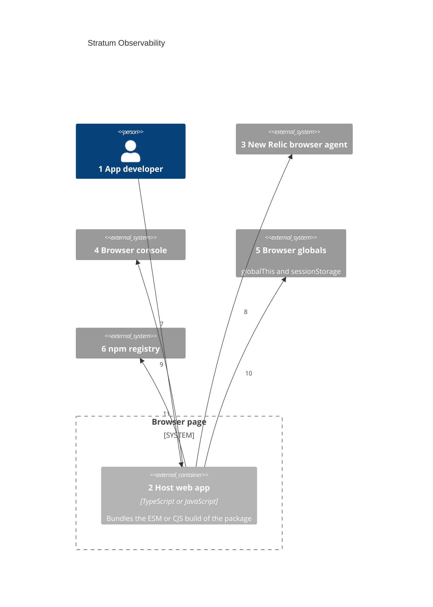
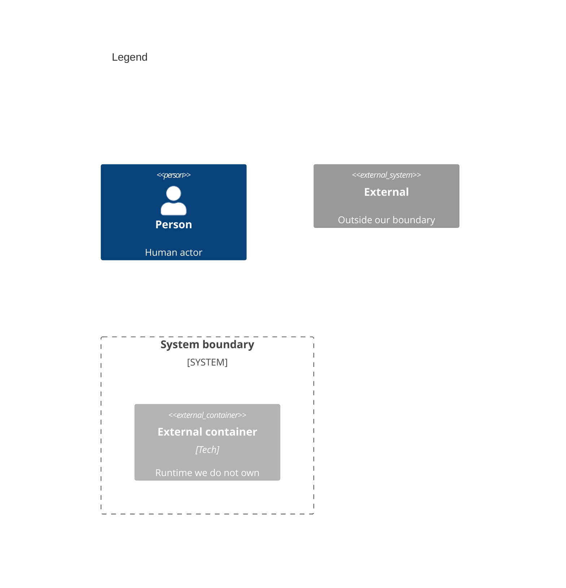

# Containers

Numbers on nodes and arrows match the callout table. Stratum owns no container: `package.json` has no `start` script, `bin`, or deploy file.

| #   | Description                                                                                                                  | Why                                                             |
| --- | ---------------------------------------------------------------------------------------------------------------------------- | --------------------------------------------------------------- |
| 1   | Same actor as the system context.                                                                                            | Adds the library to an app; never runs it alone.                |
| 2   | The only runtime. It bundles `dist/esm` or `dist/cjs`, which Rollup builds from the core and plugin entry points.            | A library runs in-process, so the host app is the container.    |
| 3   | Present only when the page loads the agent script; publishers check for it before each event.                               | A missing agent skips the publisher instead of throwing.        |
| 4   | Present in every browser and in the jsdom test environment.                                                                  | Always-available fallback destination.                          |
| 5   | Shared by every Stratum instance and every script on the page.                                                               | Cross-bundle listeners and plugins need a common home.          |
| 6   | Serves the scoped `stratum-observability` package; `package.json` maps four export paths to the built files.                        | Subpath exports keep unused plugins out of the app bundle.      |
| 7   | Imports the service and the chosen plugins.                                                                                  | Setup is code, not configuration.                               |
| 8   | Stratum code inside the app calls the agent's interaction API.                                                               | The call crosses from app code to the vendor script.            |
| 9   | Stratum code inside the app writes events and debug lines.                                                                   | Local visibility without a vendor.                              |
| 10  | Stratum code inside the app keeps listeners, global plugins, the session ID, and the debug flag.                             | State that must outlive one service instance.                   |
| 11  | The app's package manager fetches the published build.                                                                       | Versioned releases.                                             |
