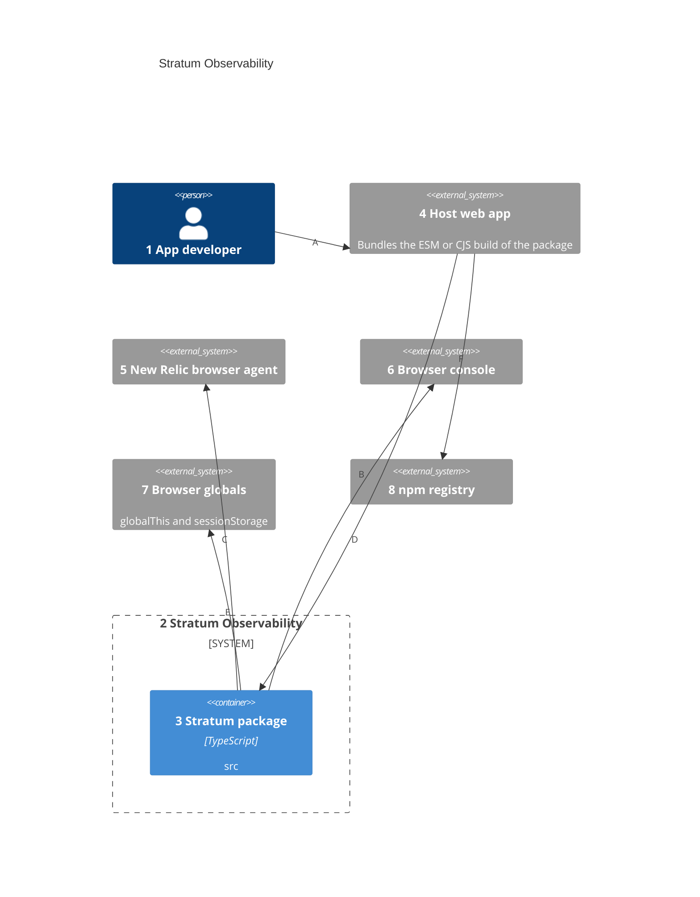
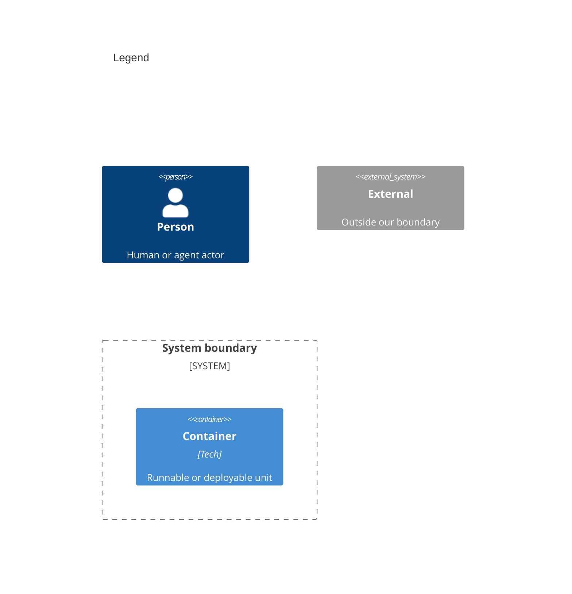

# Containers

Numbers on nodes and arrows match the callout table. Stratum ships one unit, the package, and runs inside the host app.

| #   | Description                                                                                                  | Why                                                        |
| --- | ------------------------------------------------------------------------------------------------------------ | ---------------------------------------------------------- |
| 1   | Same actor as the system context.                                                                            | Adds the library to an app; never runs it alone.           |
| 2   | Same system as the system context.                                                                           | Everything inside it ships from this repo.                 |
| 3   | The package, built from `src`. Rollup turns the core and plugin entry points into `dist/esm` and `dist/cjs`. | One shipped unit; it runs in-process in the host app.      |
| 4   | Same host app as the system context. It bundles the built package.                                           | Stratum has no runtime of its own.                         |
| 5   | Present only when the page loads the agent script; publishers check for it before each event.                | A missing agent skips the publisher instead of throwing.   |
| 6   | Present in every browser and in the jsdom test environment.                                                  | Always-available fallback destination.                     |
| 7   | Shared by every Stratum instance and every script on the page.                                               | Cross-bundle listeners and plugins need a common home.     |
| 8   | Serves the scoped `stratum-observability` package; `package.json` maps four export paths to the built files. | Subpath exports keep unused plugins out of the app bundle. |
| A   | Imports the service and the chosen plugins.                                                                  | Setup is code, not configuration.                          |
| B   | The app calls the package's service and catalogs in-process.                                                 | The call never leaves the page.                            |
| C   | The package calls the agent's interaction API.                                                               | The call crosses from app code to the vendor script.       |
| D   | The package writes events and debug lines.                                                                   | Local visibility without a vendor.                         |
| E   | The package keeps listeners, global plugins, the session ID, and the debug flag.                             | State that must outlive one service instance.              |
| F   | The app's package manager fetches the published build.                                                       | Versioned releases.                                        |
