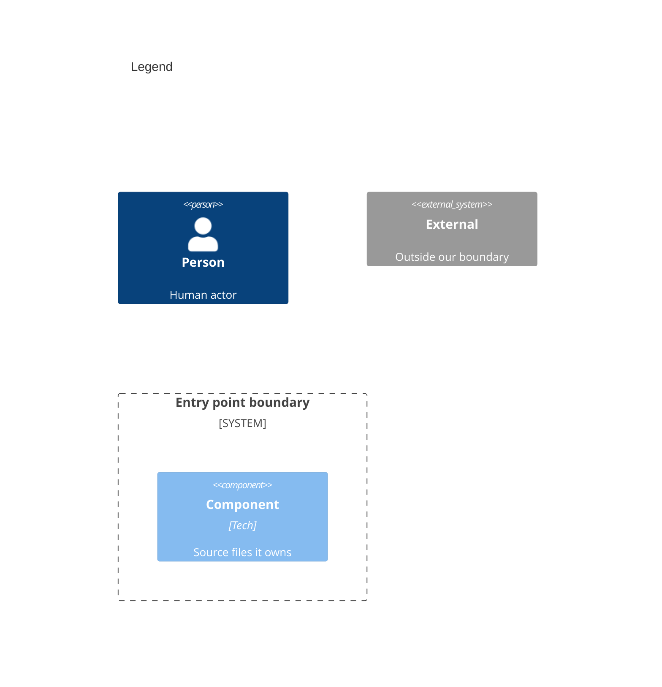

# Components

```mermaid
C4Component
    title Stratum package inside the host web app

    Person(developer, "1 App developer")

    System_Boundary(core, "Core entry point") {
        Component(service, "2 Service", "TypeScript", "src/service.ts, src/index.ts, src/constants.ts, src/types/index.ts, src/types/service.ts")
        Component(catalog, "3 Catalog registry", "TypeScript", "src/utils/catalog.ts, src/types/catalog.ts")
        Component(injector, "4 Injector", "TypeScript", "src/utils/injector.ts, src/types/plugin.ts, src/types/plugin-hooks.ts")
        Component(base, "5 Base classes", "TypeScript", "src/base")
        Component(snapshot, "6 Snapshot builder", "TypeScript", "src/utils/event.ts")
        Component(abTests, "7 A/B test manager", "TypeScript", "src/utils/ab-test-manager.ts, src/types/ab-test.ts")
        Component(globalPlugins, "8 Global plugins", "TypeScript", "src/utils/global-plugins.ts")
        Component(env, "9 Environment helpers", "TypeScript", "src/utils/env.ts, src/utils/general.ts, src/utils/index.ts, src/types/env.ts")
    }

    System_Boundary(plugins, "Plugin entry points") {
        Component(newRelicPlugin, "10 New Relic plugin", "TypeScript", "src/plugins/new-relic")
        Component(newRelicPlus, "11 New Relic Plus plugin", "TypeScript", "src/plugins/new-relic-plus")
        Component(browserConsole, "12 Browser console plugin", "TypeScript", "src/plugins/browser-console")
    }

    System_Boundary(build, "Build and test setup") {
        Component(bundler, "13 Bundler config", "Rollup", "rollup.config.mjs, rollup.config.analyze.mjs, scripts/analyze.mjs")
        Component(testConfig, "14 Test config", "Vitest", "vitest.config.mts, tool config")
    }

    System_Ext(newRelic, "15 New Relic browser agent")
    System_Ext(console, "16 Browser console")
    System_Ext(browserState, "17 Browser globals", "globalThis and sessionStorage")

    Rel(developer, service, "18")
    Rel(service, injector, "19")
    Rel(service, catalog, "20")
    Rel(service, snapshot, "21")
    Rel(service, globalPlugins, "22")
    Rel(catalog, base, "23")
    Rel(injector, base, "24")
    Rel(injector, abTests, "25")
    Rel(injector, env, "26")
    Rel(snapshot, injector, "27")
    Rel(newRelicPlugin, base, "28")
    Rel(newRelicPlus, base, "29")
    Rel(newRelicPlus, newRelicPlugin, "30")
    Rel(browserConsole, base, "31")
    Rel(newRelicPlugin, newRelic, "32")
    Rel(browserConsole, console, "33")
    Rel(env, browserState, "34")
    Rel(globalPlugins, browserState, "35")
    Rel(bundler, service, "36")
    Rel(bundler, plugins, "37")
```



Numbers on nodes and arrows match the callout table. Every product source has one owner; tests need none.

| #   | Description                                                                                                                                                        | Why                                                                     |
| --- | ------------------------------------------------------------------------------------------------------------------------------------------------------------------ | ----------------------------------------------------------------------- |
| 1   | Same actor as the containers view.                                                                                                                                 | Only the service is called directly.                                    |
| 2   | [`StratumService`](../../src/service.ts#L36-L336) holds catalogs and publishers; `src/index.ts` re-exports the public surface.                                     | One object per app keeps state in one place.                            |
| 3   | [`RegisteredStratumCatalog`](../../src/utils/catalog.ts#L19-L208) validates items into models; [`generateCatalogId`](../../src/utils/catalog.ts#L228-L237) keys it. | Invalid items drop out at registration, not at publish time.            |
| 4   | [`Injector`](../../src/utils/injector.ts#L16-L184) holds plugins, event types, registered IDs, the logger, and the session ID.                                     | Shared state reaches models and plugins without globals.                |
| 5   | [`BaseEventModel`](../../src/base/model.ts#L11-L143), [`BasePlugin`](../../src/base/plugin.ts#L13-L125), and [`BasePublisher`](../../src/base/publisher.ts#L13-L86). | The contract every plugin implements.                                   |
| 6   | [`generateStratumSnapshot`](../../src/utils/event.ts#L64-L121) assembles event data, catalog metadata, plugin context, and A/B tests.                             | Every publisher and listener sees one frozen copy.                      |
| 7   | [`AbTestManager`](../../src/utils/ab-test-manager.ts#L9-L119) tracks running tests and merges per-publish ones.                                                    | Experiments tag every event without app code per call.                  |
| 8   | [`getGlobalPlugins`](../../src/utils/global-plugins.ts#L10-L12) and its add and remove helpers keep plugins on `globalThis`.                                      | A script outside the app bundle can add a plugin.                       |
| 9   | [`Logger`](../../src/utils/env.ts#L96-L105), [`generateDefaultSessionId`](../../src/utils/env.ts#L74-L88), listener helpers, and type guards.                      | Guarded browser access in one file.                                     |
| 10  | [`NewRelicPlugin`](../../src/plugins/new-relic/index.ts#L12-L15) with [`NewRelicPublisher`](../../src/plugins/new-relic/publisher.ts#L16-L163).                   | Sends any event type to New Relic.                                      |
| 11  | [`NewRelicPlusPlugin`](../../src/plugins/new-relic-plus/index.ts#L24-L41) adds three validated event models and plugin context.                                   | Stricter New Relic events with required fields.                         |
| 12  | [`BrowserConsolePlugin`](../../src/plugins/browser-console/index.ts#L8-L11) with [`BrowserConsolePublisher`](../../src/plugins/browser-console/publisher.ts#L7-L49). | Smallest working plugin, and a template for new ones.                   |
| 13  | Rollup turns each entry point into ESM and CJS modules; the analyze script reports bundle sizes.                                                                  | One module per source keeps tree shaking intact.                        |
| 14  | Runs the test suite under jsdom with V8 source coverage.                                                                                                          | Browser globals exist in tests.                                         |
| 15  | Same agent as the system context.                                                                                                                                  | Only the New Relic publisher talks to it.                               |
| 16  | Same console as the system context.                                                                                                                                | Written by the console publisher and the logger.                        |
| 17  | Same globals as the system context.                                                                                                                                | Only environment helpers and global plugins touch them.                 |
| 18  | Constructs the service with product name, version, catalog, and plugins; then calls `publish`.                                                                    | The full public workflow.                                               |
| 19  | Registers each plugin and hands its publishers back to the service.                                                                                               | Plugin wiring lives in one method.                                      |
| 20  | Creates or extends a catalog and passes it the service's publish function.                                                                                        | `catalog.publish(key)` reaches the same pipeline.                       |
| 21  | Builds a snapshot, then clones it once per publisher with that plugin's event options.                                                                            | One publisher cannot mutate another's view.                             |
| 22  | Reads global plugins after constructor plugins.                                                                                                                   | Page-level plugins join every service.                                  |
| 23  | Instantiates the event model class mapped to each item's `eventType`.                                                                                             | Plugins add event types without touching catalogs.                      |
| 24  | Maps event types to model classes and sets each publisher's accepted models.                                                                                      | A publisher only receives events its plugin defines.                    |
| 25  | Owns one A/B test manager per service.                                                                                                                            | Tests are scoped to the instance.                                       |
| 26  | Uses the logger and session ID helpers.                                                                                                                           | Debug output and session tracking stay guarded.                         |
| 27  | Reads plugins, A/B tests, session ID, and product metadata.                                                                                                       | The snapshot is the injector's state at publish time.                   |
| 28  | Extends `BasePlugin` and `BasePublisher`.                                                                                                                          | Same contract as any custom plugin.                                     |
| 29  | Extends `BasePlugin` and `BaseEventModel`.                                                                                                                         | Validation rides on the base model's checks.                            |
| 30  | Reuses `NewRelicPublisher` and the shared `NEW_RELIC_PLUGIN_NAME`.                                                                                              | The shared name stops both plugins loading at once.                     |
| 31  | Extends `BasePlugin` and `BasePublisher`.                                                                                                                          | Same contract as any custom plugin.                                     |
| 32  | Ends any open interaction, sets Stratum attributes, names it, saves, and ends it.                                                                                 | One interaction per event.                                              |
| 33  | Logs the snapshot's event as JSON.                                                                                                                                 | Readable in developer tools.                                            |
| 34  | Stores the session ID, reads the debug flag, and appends snapshot listeners.                                                                                      | Each access is wrapped so a missing API never throws.                   |
| 35  | Keeps the global plugin list under the `stratum_global` key.                                                                                                       | Shared with the global snapshot listeners.                              |
| 36  | Uses the core index as one entry and replaces the version placeholder.                                                                                          | The built package reports its own version.                              |
| 37  | Adds one entry per plugin folder.                                                                                                                                  | A new plugin folder ships as a new subpath.                             |
