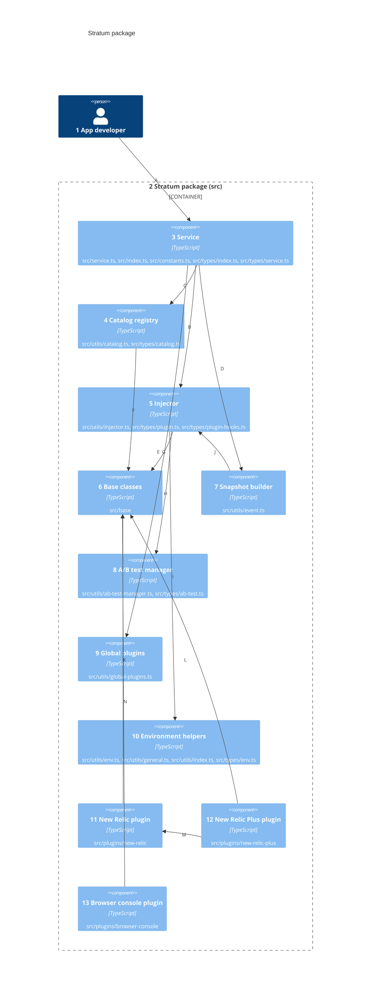
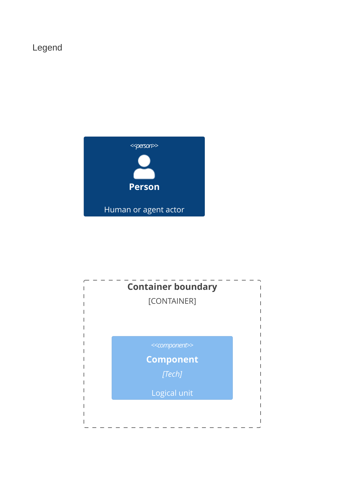

# Components

Numbers on nodes and arrows match the callout table. Every product source has one owner; tests and the Rollup and Vitest configs are tools and need none.

| #   | Description                                                                                                                                                          | Why                                                                         |
| --- | -------------------------------------------------------------------------------------------------------------------------------------------------------------------- | --------------------------------------------------------------------------- |
| 1   | Same actor as the containers view.                                                                                                                                   | Only the service is called directly.                                        |
| 2   | The package container, from `src`. Each plugin folder is also its own entry point and subpath export.                                                                | Its components split its sources.                                           |
| 3   | [`StratumService`](../../src/service.ts#L36-L341) holds catalogs and publishers; `src/index.ts` re-exports the public surface.                                       | One object per app keeps state in one place.                                |
| 4   | [`RegisteredStratumCatalog`](../../src/utils/catalog.ts#L19-L208) validates items into models; [`generateCatalogId`](../../src/utils/catalog.ts#L228-L237) keys it.  | Invalid items drop out at registration, not at publish time.                |
| 5   | [`Injector`](../../src/utils/injector.ts#L16-L184) holds plugins, event types, registered IDs, the logger, and the session ID.                                       | Shared state reaches models and plugins without globals.                    |
| 6   | [`BaseEventModel`](../../src/base/model.ts#L11-L143), [`BasePlugin`](../../src/base/plugin.ts#L13-L125), and [`BasePublisher`](../../src/base/publisher.ts#L13-L86). | The contract every plugin implements.                                       |
| 7   | [`generateStratumSnapshot`](../../src/utils/event.ts#L64-L121) assembles event data, catalog metadata, plugin context, and A/B tests.                                | Listeners share this one mutable object; each publisher gets its own clone. |
| 8   | [`AbTestManager`](../../src/utils/ab-test-manager.ts#L9-L119) tracks running tests and merges per-publish ones.                                                      | Experiments tag every event without app code per call.                      |
| 9   | [`getGlobalPlugins`](../../src/utils/global-plugins.ts#L10-L12) and its helpers keep plugins on `globalThis` under the `stratum_global` key.                         | A script outside the app bundle can add a plugin.                           |
| 10  | [`Logger`](../../src/utils/env.ts#L96-L105), [`generateDefaultSessionId`](../../src/utils/env.ts#L74-L88), listener helpers, and type guards.                        | Each `globalThis` and `sessionStorage` access is wrapped, so none throws.   |
| 11  | [`NewRelicPlugin`](../../src/plugins/new-relic/index.ts#L12-L15) with [`NewRelicPublisher`](../../src/plugins/new-relic/publisher.ts#L16-L163).                      | Saves one New Relic SPA interaction per event, for any event type.          |
| 12  | [`NewRelicPlusPlugin`](../../src/plugins/new-relic-plus/index.ts#L24-L41) adds three validated event models and plugin context.                                      | Stricter New Relic events with required fields.                             |
| 13  | [`BrowserConsolePlugin`](../../src/plugins/browser-console/index.ts#L8-L11) with [`BrowserConsolePublisher`](../../src/plugins/browser-console/publisher.ts#L7-L49). | Logs each event as JSON; the smallest working plugin.                       |
| A   | Constructs the service with product name, version, catalog, and plugins; then calls `publish`.                                                                       | The full public workflow.                                                   |
| B   | Registers each plugin and hands its publishers back to the service.                                                                                                  | Plugin wiring lives in one method.                                          |
| C   | Creates or extends a catalog and passes it the service's publish function.                                                                                           | `catalog.publish(key)` reaches the same pipeline.                           |
| D   | Builds a snapshot, then clones it once per publisher with that plugin's event options.                                                                               | One publisher cannot mutate another's view.                                 |
| E   | Reads global plugins after constructor plugins.                                                                                                                      | Page-level plugins join every service.                                      |
| F   | Instantiates the event model class mapped to each item's `eventType`.                                                                                                | Plugins add event types without touching catalogs.                          |
| G   | Maps event types to model classes and sets each publisher's accepted models.                                                                                         | Base publishers then skip other types; the bundled ones accept every event. |
| H   | Owns one A/B test manager per service.                                                                                                                               | Tests are scoped to the instance.                                           |
| I   | Uses the logger and session ID helpers.                                                                                                                              | Debug output and session tracking stay guarded.                             |
| J   | Reads plugins, A/B tests, session ID, and product metadata.                                                                                                          | The snapshot is the injector's state at publish time.                       |
| K   | Extends `BasePlugin` and `BasePublisher`.                                                                                                                            | Same contract as any custom plugin.                                         |
| L   | Extends `BasePlugin` and `BaseEventModel`.                                                                                                                           | Validation rides on the base model's checks.                                |
| M   | Reuses `NewRelicPublisher` and the shared `NEW_RELIC_PLUGIN_NAME`.                                                                                                   | The shared name stops both plugins loading at once.                         |
| N   | Extends `BasePlugin` and `BasePublisher`.                                                                                                                            | Same contract as any custom plugin.                                         |
