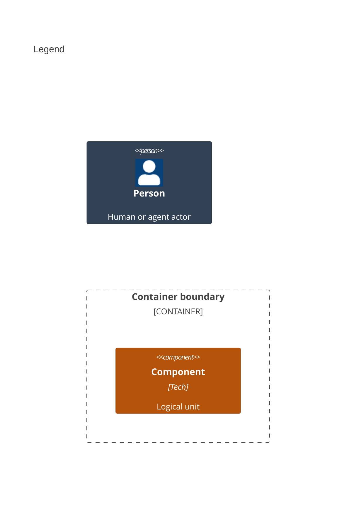

# Components

Level 3 splits the package into the service, the core and the bundled plugins. Up: [Containers](02-containers.md). Down: [Code](04-code.md).

```mermaid
C4Component
    title Stratum package

    Person(developer, "1 App developer")

    Container_Boundary(library, "2 Stratum package (src)") {
        Component(service, "3 Service", "TypeScript", "src/service.ts, src/index.ts")
        Container_Boundary(core, "4 Core") {
            Component(utils, "5 Utilities", "TypeScript", "src/utils")
            Component(model, "6 Base classes and types", "TypeScript", "src/base, src/types, src/constants.ts")
        }
        Container_Boundary(plugins, "7 Bundled plugins") {
            Component(newRelicPlugin, "8 New Relic plugin", "TypeScript", "src/plugins/new-relic")
            Component(newRelicPlus, "9 New Relic Plus plugin", "TypeScript", "src/plugins/new-relic-plus")
            Component(browserConsole, "10 Browser console plugin", "TypeScript", "src/plugins/browser-console")
        }
    }

    Rel(developer, service, "A")
    Rel(service, core, "B")
    Rel(plugins, core, "C")
    Rel(newRelicPlus, newRelicPlugin, "D")
    BiRel(utils, model, "E")

    UpdateElementStyle(developer, $bgColor="#334155", $borderColor="#1e293b", $fontColor="#ffffff")
    UpdateElementStyle(service, $bgColor="#b45309", $borderColor="#92400e", $fontColor="#ffffff")
    UpdateElementStyle(utils, $bgColor="#b45309", $borderColor="#92400e", $fontColor="#ffffff")
    UpdateElementStyle(model, $bgColor="#b45309", $borderColor="#92400e", $fontColor="#ffffff")
    UpdateElementStyle(newRelicPlugin, $bgColor="#b45309", $borderColor="#92400e", $fontColor="#ffffff")
    UpdateElementStyle(newRelicPlus, $bgColor="#b45309", $borderColor="#92400e", $fontColor="#ffffff")
    UpdateElementStyle(browserConsole, $bgColor="#b45309", $borderColor="#92400e", $fontColor="#ffffff")
    UpdateLayoutConfig($c4ShapeInRow=" 3", $c4BoundaryInRow=" 3")
```



Numbers on nodes and letters on arrows match the callout table. Every product source has one owner; tests and the Rollup and Vitest configs are tools and need none. Each arrow is an import; an arrow to a boundary reaches every part inside it.

| #   | Description                                                                                                                                                                                                                                                                                                                                                               | Why                                                                                               |
| --- | ------------------------------------------------------------------------------------------------------------------------------------------------------------------------------------------------------------------------------------------------------------------------------------------------------------------------------------------------------------------------- | ------------------------------------------------------------------------------------------------- |
| 1   | Same actor as the containers view.                                                                                                                                                                                                                                                                                                                                        | Calls the service and picks the plugins.                                                          |
| 2   | The package container, from `src`. Each plugin folder is also its own entry point and subpath export.                                                                                                                                                                                                                                                                     | Its components split its sources.                                                                 |
| 3   | [`StratumService`](../../src/service.ts#L36-L341) holds catalogs and publishers; `src/index.ts` re-exports the public surface.                                                                                                                                                                                                                                            | One object per app keeps state in one place.                                                      |
| 4   | The core the service and every plugin stand on.                                                                                                                                                                                                                                                                                                                           | Its two parts name each other at every turn.                                                      |
| 5   | [`RegisteredStratumCatalog`](../../src/utils/catalog.ts#L19-L208), the [`Injector`](../../src/utils/injector.ts#L16-L184), [`generateStratumSnapshot`](../../src/utils/event.ts#L64-L121), the [`AbTestManager`](../../src/utils/ab-test-manager.ts#L9-L119), the global plugin helpers, and the guarded [`Logger`](../../src/utils/env.ts#L96-L105) and session helpers. | Shared state reaches models and plugins without globals, and each `globalThis` access is wrapped. |
| 6   | [`BaseEventModel`](../../src/base/model.ts#L11-L143), [`BasePlugin`](../../src/base/plugin.ts#L13-L125), [`BasePublisher`](../../src/base/publisher.ts#L13-L86), the public types, and the constants.                                                                                                                                                                     | The contract every plugin implements.                                                             |
| 7   | The plugins this package ships.                                                                                                                                                                                                                                                                                                                                           | Each uses the same contract as any custom plugin.                                                 |
| 8   | [`NewRelicPlugin`](../../src/plugins/new-relic/index.ts#L12-L15) with [`NewRelicPublisher`](../../src/plugins/new-relic/publisher.ts#L16-L163).                                                                                                                                                                                                                           | Saves one New Relic SPA interaction per event, for any event type.                                |
| 9   | [`NewRelicPlusPlugin`](../../src/plugins/new-relic-plus/index.ts#L24-L41) adds three validated event models and plugin context.                                                                                                                                                                                                                                           | Stricter New Relic events with required fields.                                                   |
| 10  | [`BrowserConsolePlugin`](../../src/plugins/browser-console/index.ts#L8-L11) with [`BrowserConsolePublisher`](../../src/plugins/browser-console/publisher.ts#L7-L49).                                                                                                                                                                                                      | Logs each event as JSON; the smallest working plugin.                                             |
| A   | Constructs the service with product name, version, catalog, and the plugins it picks; then calls `publish`.                                                                                                                                                                                                                                                               | The full public workflow.                                                                         |
| B   | The service registers catalogs and plugins through the injector, builds snapshots, and reads global plugins.                                                                                                                                                                                                                                                              | Plugin wiring lives in one method.                                                                |
| C   | Plugins extend the base classes and read the public types; the New Relic publisher also uses a general helper.                                                                                                                                                                                                                                                            | Same contract as any custom plugin.                                                               |
| D   | Reuses `NewRelicPublisher` and the shared `NEW_RELIC_PLUGIN_NAME`.                                                                                                                                                                                                                                                                                                        | The shared name stops both plugins loading at once.                                               |
| E   | Utilities build models and type every value; the base classes reach the injector and the event helpers.                                                                                                                                                                                                                                                                   | These are the back references worth cutting.                                                      |
