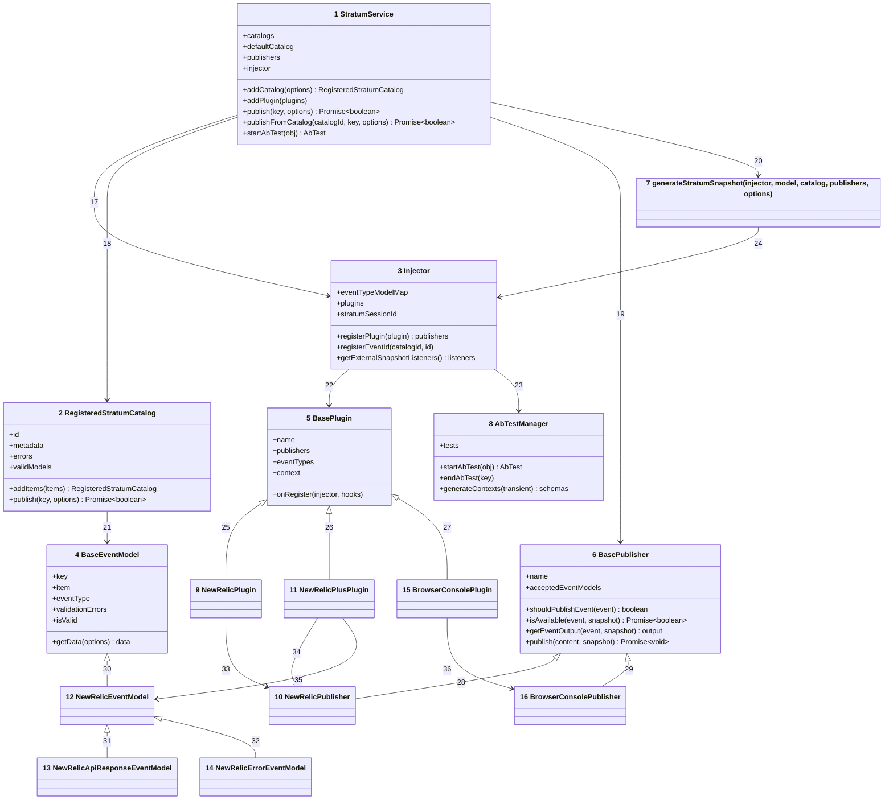
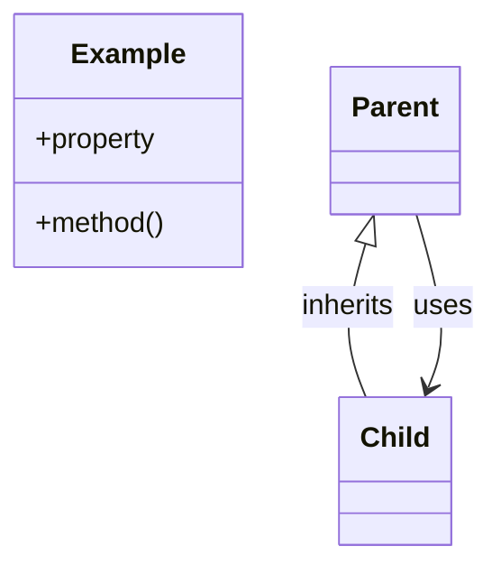

# Code

Numbers on classes and relationships match the callout table.

| #   | Description                                                                                                                                         | Why                                                                |
| --- | --------------------------------------------------------------------------------------------------------------------------------------------------- | ------------------------------------------------------------------ |
| 1 | [Source](../../src/service.ts#L36-L336); [`publishFromCatalog`](../../src/service.ts#L197-L264) runs the publish outcomes below.          | Public entry point.                                                |
| 2 | [Source](../../src/utils/catalog.ts#L19-L208); [`addItems`](../../src/utils/catalog.ts#L114-L128) runs the item outcomes below.     | Catalog state and its typed publish shortcut.                      |
| 3 | [Source](../../src/utils/injector.ts#L16-L184); [`registerPlugin`](../../src/utils/injector.ts#L133-L168) skips duplicate names.    | Plugin, event type, and event ID registry.                         |
| 4 | [Source](../../src/base/model.ts#L11-L143); the constructor clones the item and validates ID, uniqueness, and description.            | Default model for the `base` event type.                           |
| 5 | [Source](../../src/base/plugin.ts#L13-L125); `setContext` only changes keys the context already has.                                  | The shape every plugin declares.                                   |
| 6 | [Source](../../src/base/publisher.ts#L13-L86); `shouldPublishEvent` accepts only models listed in `acceptedEventModels`.            | The four steps every destination implements.                       |
| 7 | [Source](../../src/utils/event.ts#L64-L121); prefixes each plugin's context keys unless the plugin opts out.                          | A free function, so it is drawn as a node with no members.         |
| 8 | [Source](../../src/utils/ab-test-manager.ts#L9-L119); IDs come from a static counter, `t1`, `t2`, and so on.                | Running tests plus per-publish extras.                             |
| 9 | [Source](../../src/plugins/new-relic/index.ts#L12-L15); named `newRelic`, no event types.                                | Accepts every event type.                                          |
| 10 | [Source](../../src/plugins/new-relic/publisher.ts#L16-L163); available only when the agent global exists.            | Maps snapshot fields to interaction attributes.                    |
| 11 | [Source](../../src/plugins/new-relic-plus/index.ts#L24-L41); prefix `stratum`, context from `defaultContext`.        | Plugin context travels with every event.                           |
| 12 | [Source](../../src/plugins/new-relic-plus/model.ts#L11-L41); requires a non-empty `name`.                           | The `nrEvent` type.                                                |
| 13 | [Source](../../src/plugins/new-relic-plus/model.ts#L49-L72); requires string `requestUri` and `statusCode`.          | The `nrApiResponse` type.                                          |
| 14 | [Source](../../src/plugins/new-relic-plus/model.ts#L80-L99); requires a string `errorCode`.                          | The `nrError` type.                                                |
| 15 | [Source](../../src/plugins/browser-console/index.ts#L8-L11); named `browserConsole`.                               | Accepts every event type.                                          |
| 16 | [Source](../../src/plugins/browser-console/publisher.ts#L7-L49); available wherever `console` is defined.     | Prints the event as JSON.                                          |
| 17  | Creates the injector in the constructor and calls `registerPlugin`.                                                                                 | All shared state hangs off one injector.                           |
| 18  | Constructs catalogs, or calls `addItems` on an existing ID.                                                                                         | Duplicate catalog IDs merge instead of failing.                    |
| 19  | Filters, checks, maps, and publishes through each publisher in its own microtask.                                                                   | A slow destination never blocks the app.                           |
| 20  | Builds one snapshot per publish call.                                                                                                               | Listeners and publishers share one source of truth.                |
| 21  | Instantiates the model class registered for the item's event type.                                                                                  | Validation lives on the model.                                     |
| 22  | Stores plugins by name and reads their event types and publishers.                                                                                  | First plugin with a name wins.                                     |
| 23  | Owns the A/B test manager.                                                                                                                          | One manager per service instance.                                  |
| 24  | Reads plugins, context, tests, and metadata.                                                                                                        | The snapshot copies state, never references it.                    |
| 25  | Inherits from the base plugin.                                                                                                                      | Bundled and custom plugins share one contract.                     |
| 26  | Inherits from the base plugin.                                                                                                                      | Same contract, with typed options.                                 |
| 27  | Inherits from the base plugin.                                                                                                                      | Same contract, nothing extra.                                      |
| 28  | Inherits from the base publisher.                                                                                                                   | Overrides `shouldPublishEvent` to accept everything.               |
| 29  | Inherits from the base publisher.                                                                                                                   | Overrides `shouldPublishEvent` to accept everything.               |
| 30  | Adds the `name` rule to the base checks.                                                                                                            | Each subclass calls the parent check first.                        |
| 31  | Adds request fields to the data.                                                                                                                    | API response events carry status and URI.                          |
| 32  | Adds error fields to the data.                                                                                                                      | Error events carry code, text, and reason.                         |
| 33  | Creates one publisher instance.                                                                                                                     | One instance per plugin.                                           |
| 34  | Reuses the New Relic publisher.                                                                                                                     | No second publisher to maintain.                                   |
| 35  | Maps the three event types to models.                                                                                                               | The type string picks the model class.                             |
| 36  | Creates one publisher instance.                                                                                                                     | One instance per plugin.                                           |

## Publish outcomes

| Outcome                  | When                                                             | Result                         |
| ------------------------ | ---------------------------------------------------------------- | ------------------------------ |
| Missing or invalid key   | The catalog ID or the key has no valid model                     | `false`, debug line logged     |
| No publishers            | No publisher accepts the model                                   | `true`, listeners still called |
| All published            | Every accepting publisher is available and publishes             | `true`                         |
| A publisher unavailable  | Any `isAvailable` resolves `false`                               | `false`, debug line logged     |

## Catalog item outcomes

| Outcome                  | When                                                             | Recorded in                    |
| ------------------------ | ---------------------------------------------------------------- | ------------------------------ |
| Valid                    | Known event type and every model check passes                   | `validModels`, event ID registered |
| Duplicate key            | The key is already a valid model in this catalog                 | `errors`                       |
| Unknown event type       | No plugin registered the item's `eventType`                      | `errors`                       |
| Model rejected           | The model's checks fail, such as a duplicate ID                  | `errors`, with each message    |
