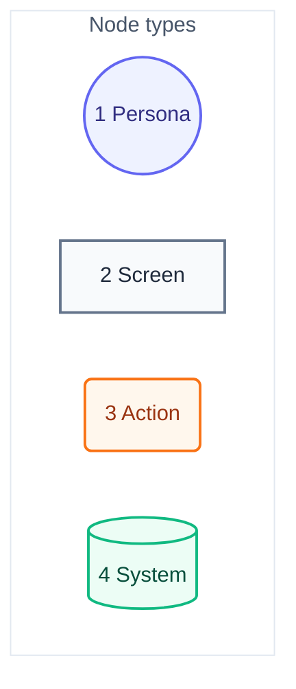
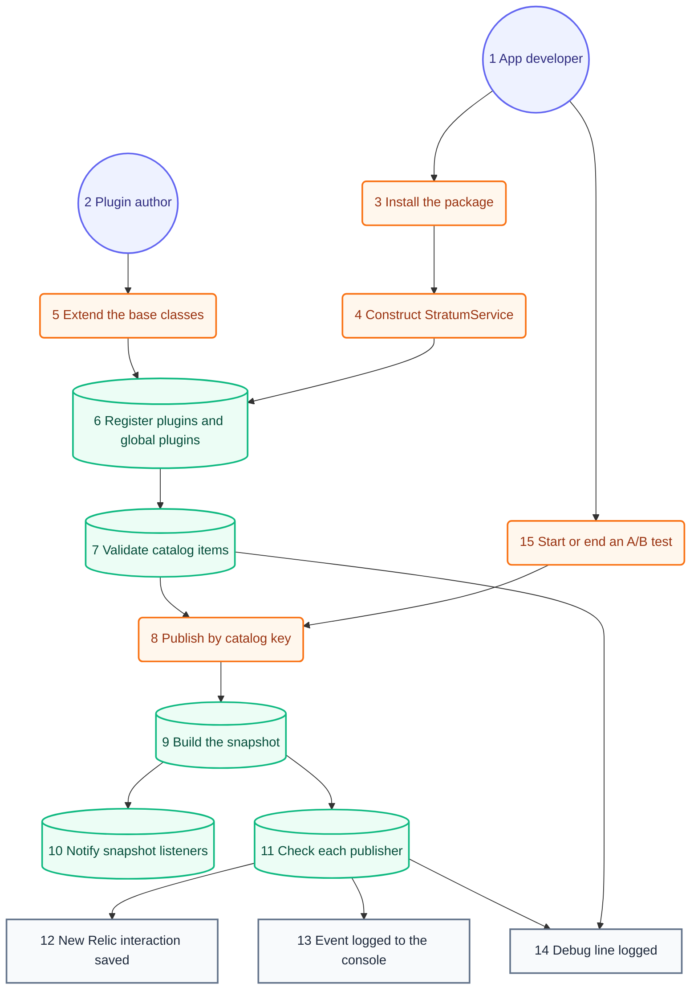

# User Journey

## Legend

Numbers match the callout table. "Screen" is output the developer sees, not a GUI view; this is a library.

| #   | Description  | Why                                                        |
| --- | ------------ | ---------------------------------------------------------- |
| 1   | Persona      | Someone who adds Stratum to an app or writes a plugin.     |
| 2   | Screen       | What the developer sees: a destination record or a log.    |
| 3   | Action       | A call the app code makes.                                 |
| 4   | System       | Work Stratum does inside the call.                         |

## App developer journey

Each step will name the requirement docs it fulfils once `docs/requirements` exists.

Numbers match the callout table. System context: [01-system-context.md](01-system-context.md). Components: [03-components.md](03-components.md). Code: [04-code.md](04-code.md).

| #   | Description                                                                                                          | Type    | Why                                                             |
| --- | -------------------------------------------------------------------------------------------------------------------- | ------- | --------------------------------------------------------------- |
| 1   | Same actor as the system context.                                                                                    | Persona | Owns the app and its catalogs.                                  |
| 2   | Same actor as the system context.                                                                                    | Persona | Reaches a new destination without changing the core.            |
| 3   | Adds the package and imports a plugin subpath.                                                                      | Action  | Only imported plugins enter the bundle.                         |
| 4   | Passes product name, version, a default catalog, and plugins to the constructor.                                     | Action  | Setup happens once per app.                                     |
| 5   | Subclasses the base plugin, publisher, and model, then passes the plugin to the service.                             | Action  | Custom destinations use the same contract as bundled ones.      |
| 6   | Registers constructor plugins first, then any on `globalThis`; a duplicate name is skipped.                          | System  | Event types exist before catalogs need them.                    |
| 7   | Keeps valid items as models and records errors for the rest.                                                         | System  | Bad items never reach a publisher.                              |
| 8   | Calls `publish`, `publishFromCatalog`, or `catalog.publish` with optional replacements and plugin data.              | Action  | One call per user action.                                       |
| 9   | Collects event data, catalog metadata, plugin context, session ID, and A/B tests.                                    | System  | Every destination gets the same facts.                          |
| 10  | Calls global and per-product listeners in a microtask.                                                               | System  | Page scripts observe events without a plugin.                   |
| 11  | Asks each accepting publisher whether it is available, then maps and publishes.                                      | System  | A missing destination is skipped, and the call resolves false.  |
| 12  | One SPA interaction with Stratum attributes and the event name.                                                      | Screen  | Queryable in New Relic.                                         |
| 13  | One JSON line per event.                                                                                             | Screen  | Instant feedback in developer tools.                            |
| 14  | Shown only when session storage holds the `DEBUG_KEY` flag as `true`.                                                    | Screen  | Explains dropped items and skipped publishers.                  |
| 15  | Calls `startAbTest`, `endAbTest`, or `endAllAbTests`.                                                                | Action  | Running tests tag every later event.                            |
