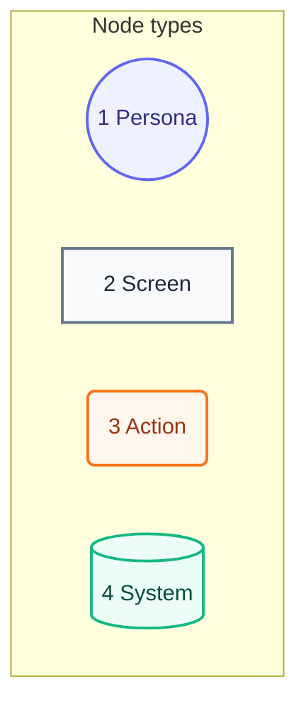
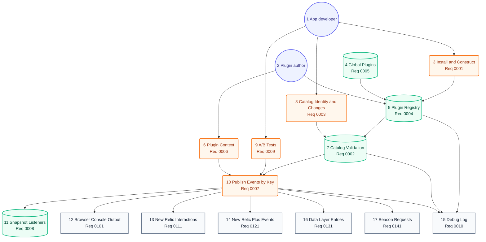

# User Journey

Up: [Code](04-code.md).

## Legend

Numbers match the callout table. "Screen" is output the developer sees, not a GUI view; this is a library.

| #   | Description | Why                                                     |
| --- | ----------- | ------------------------------------------------------- |
| 1   | Persona     | Someone who adds Stratum to an app or writes a plugin.  |
| 2   | Screen      | What the developer sees: a destination record or a log. |
| 3   | Action      | A call the app code makes.                              |
| 4   | System      | Work Stratum does inside the call.                      |

## Journey

Numbers match the callout table.

| #   | Description                                                                         | Type    | Why                                                  |
| --- | ----------------------------------------------------------------------------------- | ------- | ---------------------------------------------------- |
| 1   | Same actor as the system context.                                                   | Persona | Owns the app and its catalogs.                       |
| 2   | Same actor as the system context.                                                   | Persona | Reaches a new destination without changing the core. |
| 3   | [0001](../requirements/0001-engine-install-and-construct.md): 0001.1 to 0001.8.     | Action  | One package and one service per app.                 |
| 4   | [0005](../requirements/0005-engine-global-plugins.md): 0005.1 to 0005.4.            | System  | Page scripts add plugins without touching app code.  |
| 5   | [0004](../requirements/0004-engine-plugin-registry.md): 0004.1 to 0004.7.           | System  | Event types exist before catalogs need them.         |
| 6   | [0006](../requirements/0006-engine-plugin-context.md): 0006.1 to 0006.3.            | Action  | Plugin context travels with every event.             |
| 7   | [0002](../requirements/0002-engine-catalog-validation.md): 0002.1 to 0002.6.        | System  | Bad items never reach a publisher.                   |
| 8   | [0003](../requirements/0003-engine-catalog-changes.md): 0003.1 to 0003.8.           | Action  | Catalogs change while the app runs.                  |
| 9   | [0009](../requirements/0009-engine-ab-tests.md): 0009.1 to 0009.3.                  | Action  | Running tests tag every later event.                 |
| 10  | [0007](../requirements/0007-engine-publish-events.md): 0007.1 and 0007.3 to 0007.9. | Action  | One call per user action.                            |
| 11  | [0008](../requirements/0008-engine-snapshot-listeners.md): 0008.1 to 0008.3.        | System  | Page scripts observe events without a plugin.        |
| 12  | [0101](../requirements/0101-plugin-browser-console-output.md): 0101.1.              | Screen  | Instant feedback in developer tools.                 |
| 13  | [0111](../requirements/0111-plugin-new-relic-interactions.md): 0111.1 to 0111.4.    | Screen  | Queryable in New Relic.                              |
| 14  | [0121](../requirements/0121-plugin-new-relic-plus-events.md): 0121.1 to 0121.5.     | Screen  | Typed New Relic events with prefixed context.        |
| 15  | [0010](../requirements/0010-engine-debug-log.md): 0010.1 to 0010.4.                 | Screen  | Explains dropped items and skipped publishers.       |
| 16  | [0131](../requirements/0131-plugin-data-layer-entries.md): 0131.1 to 0131.4.        | Screen  | Tag managers see every event.                        |
| 17  | [0141](../requirements/0141-plugin-beacon-requests.md): 0141.1 to 0141.6.           | Screen  | A team's own collector sees every event.             |
