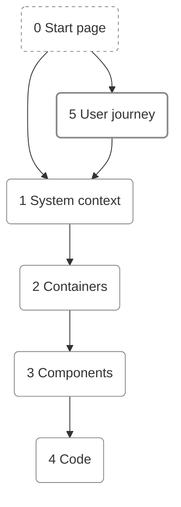
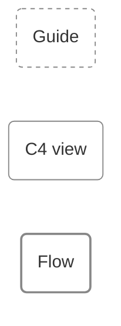

# Architecture

Level 0 is this start page: it maps the five views, the words they share, and where to begin a change. What Stratum is lives in [System context](01-system-context.md).

Numbers on nodes match the callout table.

| #   | Description                                                                         | Why                                                    |
| --- | ----------------------------------------------------------------------------------- | ------------------------------------------------------ |
| 0   | This page: the reading order, the glossary, and where to change X.                  | One place to start, so no view repeats the others.     |
| 1   | [System context](01-system-context.md): who uses Stratum, and what sits outside it. | Read first to learn the ideas.                         |
| 2   | [Containers](02-containers.md): what ships, and how an app loads it.                | Each plugin is its own entry point.                    |
| 3   | [Components](03-components.md): which parts of `src` own which job.                 | Read first to change code.                             |
| 4   | [Code](04-code.md): which classes run a publish or register a plugin.               | The deepest view, linked to source lines.              |
| 5   | [User journey](05-user-journey.md): what a developer does, and what happens next.   | Ties the views to the [requirements](../requirements). |

## Glossary

| Term              | Meaning                                                                                                     |
| ----------------- | ----------------------------------------------------------------------------------------------------------- |
| Catalog           | The set of events an app may publish, each under a key.                                                     |
| Catalog key       | The name an app passes to `publish` to pick one catalog item.                                               |
| Event type        | A string on a catalog item that selects which event model checks it.                                        |
| Event model       | A class that validates one catalog item and returns its data.                                               |
| Plugin            | A bundle of event types and publishers for one destination.                                                 |
| Publisher         | The class that sends one event to one destination.                                                          |
| Snapshot          | One copy of an event's data, metadata, plugin context and A/B test schemas, built per publish call.         |
| Snapshot listener | A function that receives each snapshot, without being a plugin.                                             |
| Global plugin     | A plugin placed on `globalThis` so another script can add it to every service.                              |
| Plugin context    | Extra values a plugin adds to every snapshot, under its own prefix.                                         |
| A/B test          | A running test whose schema rides on every snapshot until the app ends it.                                  |
| Injector          | The object that holds plugins, event types, event IDs, the A/B test manager, the logger and the session ID. |
| Debug flag        | The `stratumdb` session storage value that turns on debug lines.                                            |

## Where to change X

| Change                       | Start in                                              | View                                  |
| ---------------------------- | ----------------------------------------------------- | ------------------------------------- |
| Add a destination plugin     | A new folder under `src/plugins`; Rollup finds it     | [Components](03-components.md), row 7 |
| Add an event type            | `eventTypes` on a plugin, with a `BaseEventModel`     | [Code](04-code.md), rows 4 and 5      |
| Change how a publisher sends | The publisher's `getEventOutput` and `publish`        | [Code](04-code.md), row 6             |
| Change what a snapshot holds | `generateStratumSnapshot` in `src/utils/event.ts`     | [Code](04-code.md), row 7             |
| Change catalog validation    | `RegisteredStratumCatalog` and the event models       | [Code](04-code.md), rows 2 and 4      |
| Change A/B test handling     | The `AbTestManager` in `src/utils/ab-test-manager.ts` | [Code](04-code.md), row 8             |
| Add or change a debug line   | The `Logger` in `src/utils/env.ts`                    | [Code](04-code.md), row 17            |
